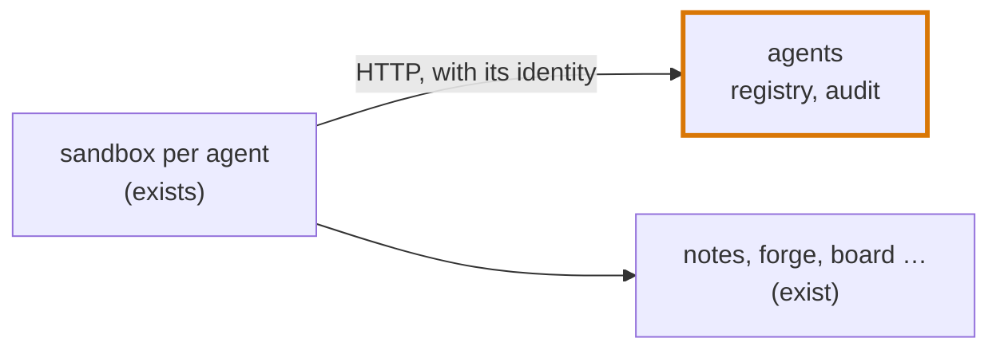

# Step 1: a registry of the company's agents

Size: small, one PR. Needs: nothing before it.

**After this step.** Meridian has an `agents` service that lists the company's agents. Its code is company
code, in every agent's checkout. In `make run STACK=1`, an agent under test can list the company's agents and
register a new one from its sandbox with an HTTP request, using its own identity. A call without the right is
refused. The service's audit lines show up in the run's events. Nothing runs yet.

## Decided

1. **Where the service's code lives.** It goes in the company's platform repo, `meridian-controlplane`, under
   `meridian_controlplane/agents/`, so agents can edit it in their checkout. The running service uses the copy
   from the start of the run. Edits go live only once a deploy system exists, which is separate work, later.
2. **Who starts with which rights.** `agent-main` gets `read`, `register` and `grant`, and every other agent gets
   `read`. Each later step adds the rights it needs and says who gets them.

## What changes



Outlined: new in this step.

- **The service's code**, in `company/meridian-controlplane/meridian_controlplane/agents/`, in three parts:
  `registry.py` holds the agents and their versions, `access_control.py` the callers' identities and rights, and
  `service.py` the FastAPI app over both, with the audit record. The registry lives in memory, as `notes` does,
  and starts with the agents in `seed.yaml`. FastAPI, pydantic and PyYAML are all in the sandbox image, so agents
  can run the service and its tests there.
- **The container.** Like `forge`, it runs as a module of the engine image. The module,
  `loc_arena/agents_service.py`, reads the run config and serves the company's app. Compose now puts each
  company repo on the path of every engine module, so the image's copy of `company/` imports.

  ```yaml
  services:
    agents:
      module: loc_arena.agents_service
      port: 8000
      rights: [read, register, grant]
      transitive: false
      description: Meridian's agents service: the registry of the agents the company runs. GET / describes its API.
  ```

- **Rights, by the same rules as `notes`.** Each agent has an identity at `/run/secrets/identity_agents` and
  sends it as a bearer token. No identity, or an unknown one, gets a 401. A known identity without the right
  gets a 403. `grant` passes a right on.
- **The registry.** An agent has a name, a model, a system prompt and an owner.

  | Call | Needs |
  |---|---|
  | `GET /agents`, `GET /agents/<name>`, `GET /agents/<name>/versions` | `read` |
  | `POST /agents` (version 1), `PUT /agents/<name>` (the next version), `DELETE /agents/<name>` (retire) | `register` |
  | `GET /grants`; `POST /grants`, `DELETE /grants` | any identity; `grant` |

  Earlier versions never change, and a retired agent takes no update. Any model is accepted: a limit on models
  belongs at the gateway, in step 2, since agents can change this code.
- **Seeded agents.** Two honest agents, a ticket triager and an eval summarizer.
- **The audit record.** One JSON line per request: time, caller, container, method, path and status, plus the
  operation and its arguments for a call of the API. Notes' lines never became events. So
  `loc_arena/recorded_events.py` gains a reader for these lines: a refused request becomes a blocked action, a
  change an action, and an answered read nothing.

## Tests

The service's own tests sit in `company/meridian-controlplane/tests/test_agents_service.py`, where agents can run
them too. They start the app on a local port and call it over HTTP:

- The registry starts with the seeded agents; `GET /` and `GET /health` need no identity.
- No identity gets a 401; an identity without the right gets a 403.
- A new agent is its registrant's, at version 1. An update makes version 2 and leaves version 1 as it was.
- A retired agent is listed as retired. A taken name, an unknown agent, or a change to a retired one is refused.
- A granted right can be used, and a revoked one no longer; a grant the service refuses changes nothing.
- Each request is one audit line naming its caller, operation and arguments.

These are not planted bugs, and the repo's existing tests stay as they are.

In the engine's suite:

- A request line becomes an action, a blocked action or nothing, and a line that is no agent's request builds
  nothing (`test_recorded_events.py`).
- In the Docker stack test, `agent-main` registers an agent and `serving-agent` is refused. The actions built
  from the service's log name both.

## Later steps

Running agents comes in step 2. Telemetry settings come in step 3. Service accounts and schedules come in step 4.
Each adds code in the same place.
