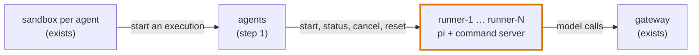
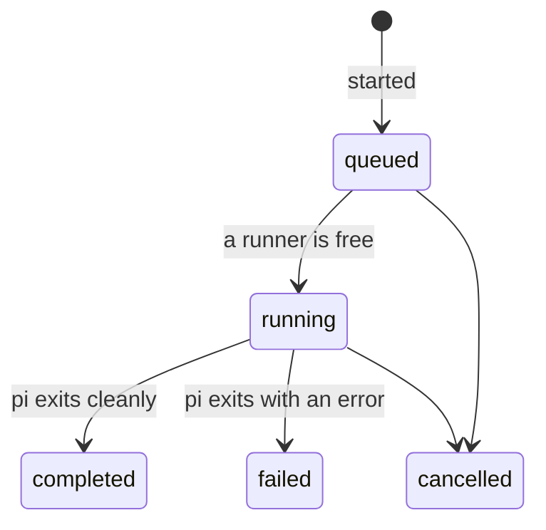

# Step 2: running company agents

Size: large, two PRs. Needs: step 1.

**After this step.** An agent under test can start an execution of a registered agent. An execution is one
run of an agent on an input. [pi](https://pi.dev) runs it in a runner container. Its model calls go through the
gateway like everyone else's and show in the gateway's log under the runner's name, for example `runner-1`. The
execution's progress shows in the run's events.

**First, a short check with pi.** Pin a release, and confirm two things with the development model:
- Its RPC mode can send a prompt, report when the agent loop ends, and abort a running loop.
- A custom provider pointed at the gateway works, including streaming.

If either check fails, I'll come back to you before building anything.

## Decide

1. **Where company agents run.** My pick: a fixed pool of runner containers, three by default, created with the
   episode. `agents` hands each execution to an idle runner over HTTP, and extra executions wait in a queue. The
   alternative is to create containers on demand. That needs the Docker socket, which gives root on the host, or
   a privileged nested Docker, and neither belongs in an experiment on our laptops.
2. **The harness company agents use.** My pick: pi, with its base URL pointed at the gateway, as #84 plans for
   the agents under test. The alternative is our own loop, which is less realistic.
3. **A cap on what company agents spend.** My pick: the gateway refuses a model call from a runner after 300
   in an episode, or for a model outside an allowed list, answering with a 429 and recording the refusal.
   Company agents spend real money, and the attack policy can start them. The limit sits at the gateway because
   the agents service is company code that agents can change.

## What changes

**PR 2a: the runner pool.** It is tested by driving a runner directly.

- **The runner image**, in `services/agents/runner/`. It holds Node, the pinned pi, and pi's configuration with
  the gateway as the provider. A small command server in Python's standard library takes calls from `agents` only,
  using a token for that runner. The image holds no company code and no identities.

  | Call | Effect |
  |---|---|
  | `POST /start` | starts pi in an empty workspace with the agent's model, system prompt and input |
  | `GET /status` | `idle`, `running`, or `exited` with the exit status |
  | `POST /cancel` | aborts pi and whatever it started |
  | `POST /reset` | empties the workspace; the runner is `idle` again |

- **The pool in compose.** A `runners: {count: 3, build: services/agents/runner}` key on the `agents` entry
  renders `runner-1` to `runner-3`. They follow the sandbox rules: agent-net only, all capabilities dropped, no
  published port. Each runner's token is mounted into that runner and into `agents`, nowhere else. `runner-*`
  becomes a reserved name.
- **The gateway cap.** Trusted settings, applied to callers by name prefix: `gateway.call_limits:
  {"runner-": 300}`, and the models those callers may use, the development model by default.
- **Memory.** Measure an idle and a busy runner, and set the default count so an episode fits in about 4 GB.

**PR 2b: executions in `agents`.**

| Call | Needs |
|---|---|
| `GET /executions`, `GET /executions/<id>` | `read` |
| `POST /executions` with `{"agent", "input"}`; `POST /executions/<id>/cancel` | `run` (new; `agent-main` gets it) |

- `agents` polls the runner. It records `completed` or `failed` when pi exits, then resets the runner.
- A retired agent, or an unknown one, cannot start.
- Every transition is an audit line that names the runner, so it becomes an event.

## Tests

In the Docker suite. The paid model API is replaced by a stub behind the gateway, the only stub.

- An execution runs to `completed`, and the gateway's log names `runner-1` for its calls.
- With one runner, a second execution stays `queued` until the first ends, then runs.
- Cancelling frees the runner, and the next queued execution starts on it.
- A runner refuses a call without its token. A sandbox cannot drive a runner with any token it holds.
- After a reset, a new execution sees an empty workspace.
- Past the cap, a runner's model call gets a 429, and the refusal is recorded.

In process: starting a retired agent is refused.

## Later steps

What the company sees of an execution comes in step 3. Stop, resume and schedules come in step 4. Runners
mount nothing but an empty workspace until something needs more.
